<p align="center">
  
</p>

<h1 align="center">Garmin Hub</h1>
<p align="center"><strong>Personal Fitness &amp; Running Performance</strong></p>
<p align="center">Deine ruhige Übersicht über Gesundheit, Training und Fortschritt: Garmin-Daten, ein adaptiver Trainingsplan und ein ehrlicher Blick auf deine Entwicklung.</p>

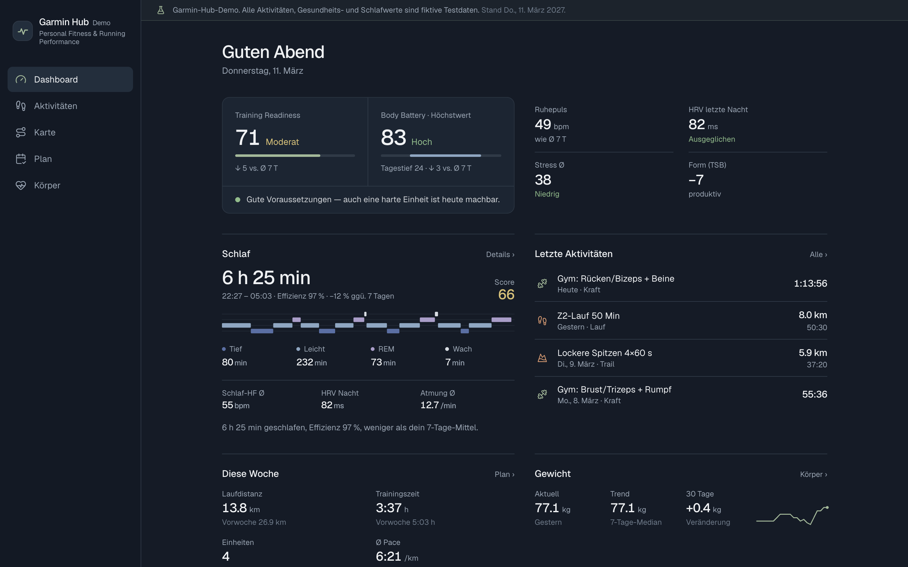

Garmin Hub holt Aktivitäten, Gesundheits-, Schlaf- und Gewichtsdaten von Garmin
Connect und wertet sie mit einer regelbasierten Engine aus. Daraus entstehen ein
Dashboard, ein adaptiver Trainingsplan für **Laufleistung, Ausdauer und allgemeine
Fitness** und ein Körperbereich mit Smart Weight Tracking.

Die App ist ein **persönliches Single-User-Projekt**. Sie läuft komplett im Free Tier
von Vercel und Supabase, nutzt keine bezahlten Dienste und keine Sprachmodelle.
Die Oberfläche ist für das Smartphone gestaltet und lässt sich als PWA installieren.

> [!WARNING]
> Garmin Hub verwendet die **inoffizielle Garmin-Connect-API** (`garminconnect` und
> `garth`). Garmin unterstützt diese Anbindung nicht. Die Nutzung erfolgt auf eigenes
> Risiko und ist nur für das eigene Konto gedacht. Mehr dazu unter
> [Sicherheit und Datenschutz](#sicherheit-und-datenschutz).

## Ein Blick in die App

<table>
  <tr>
    <th>Dashboard</th>
    <th>Wochenplan</th>
    <th>Smart Weight Tracking</th>
  </tr>
  <tr>
    <td>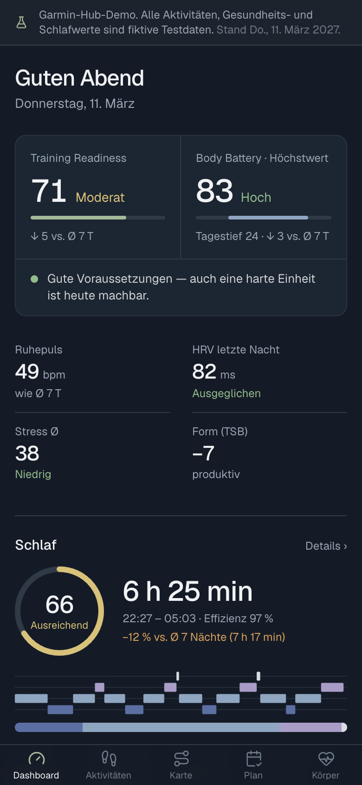</td>
    <td>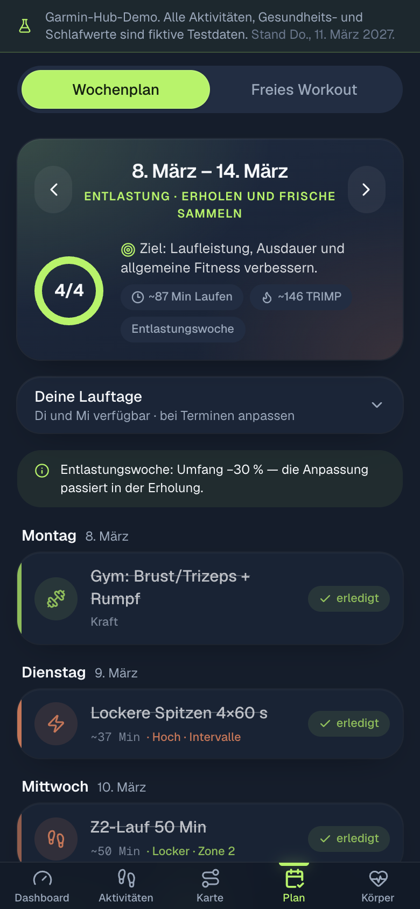</td>
    <td>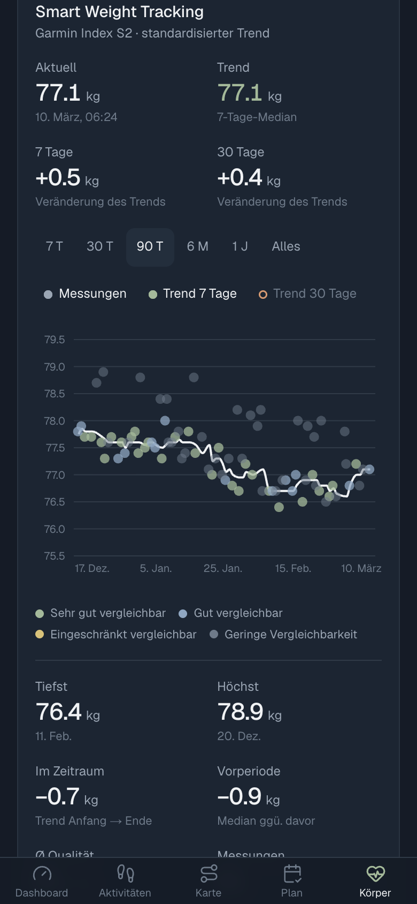</td>
  </tr>
  <tr>
    <th>Aktivitäten</th>
    <th>Aktivitätsdetail</th>
    <th>Messprotokoll</th>
  </tr>
  <tr>
    <td>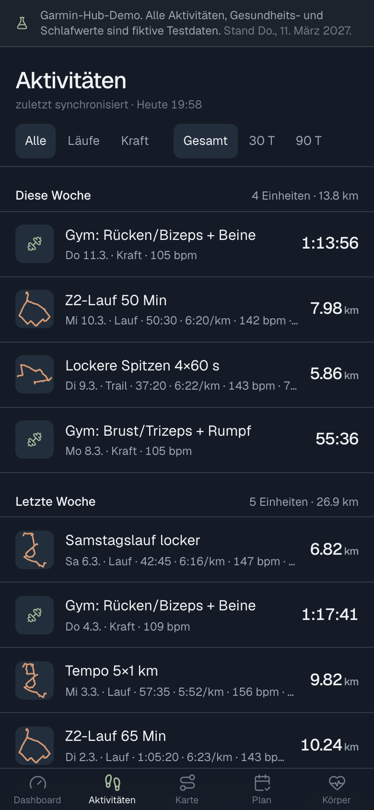</td>
    <td>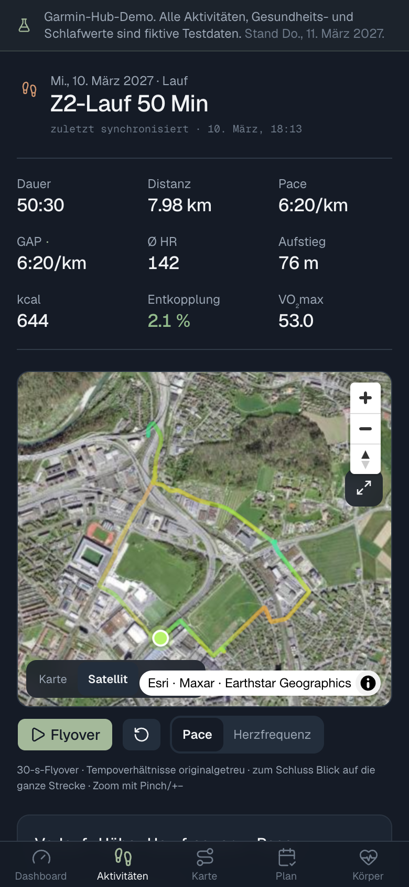</td>
    <td>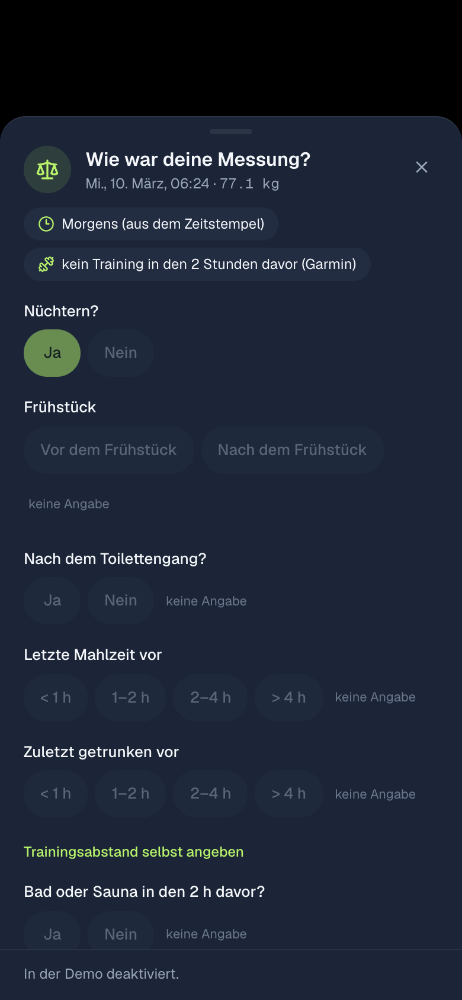</td>
  </tr>
  <tr>
    <th>Woche &amp; Fortschritt</th>
    <th>Routen-Builder</th>
    <th>Schlaf</th>
  </tr>
  <tr>
    <td>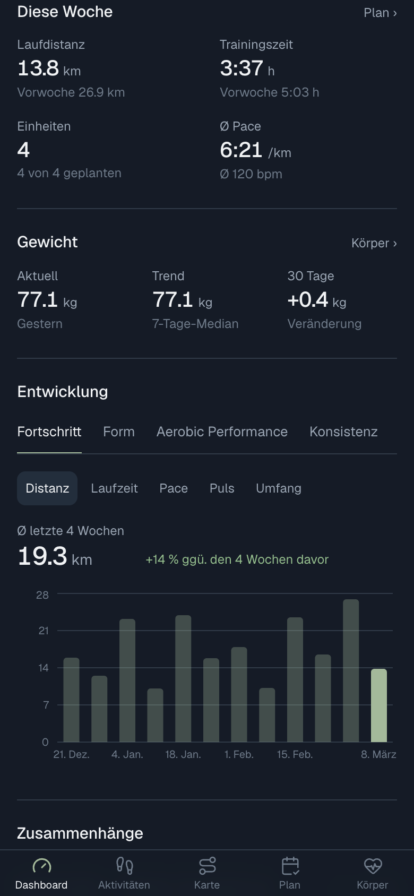</td>
    <td>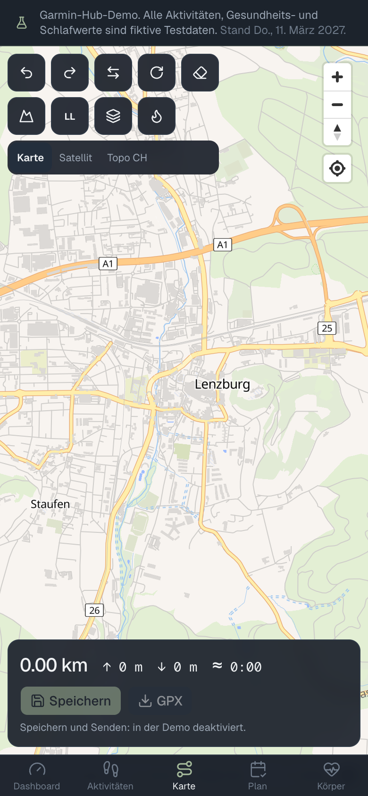</td>
    <td>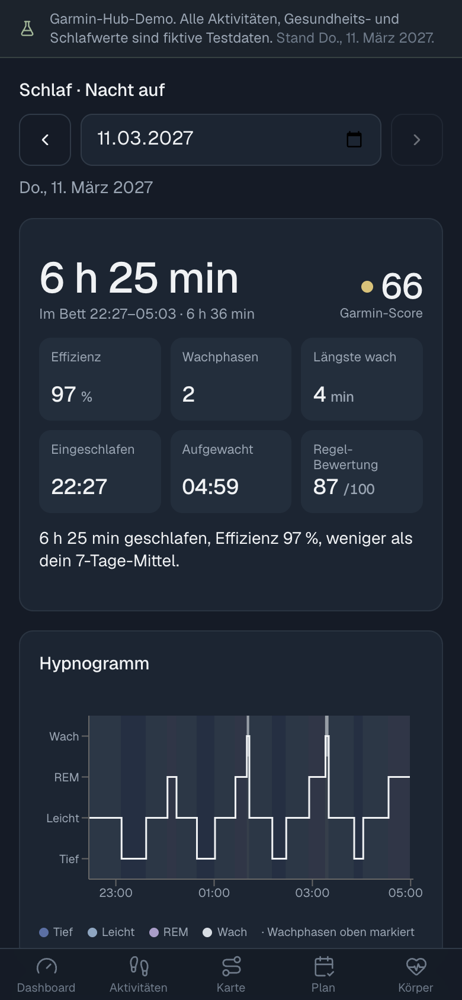</td>
  </tr>
</table>

Alle Screenshots stammen aus der öffentlichen [Demo](#öffentliche-demo) mit
**fiktiven** Daten. Echte Garmin-Daten kommen in keiner Aufnahme vor.

## Was Garmin Hub kann

| Bereich | Funktionen |
| --- | --- |
| **Dashboard** | Gesundheitsübersicht: Training Readiness und Body Battery mit Einstufung und 7-Tage-Vergleich, Einschätzung für den Tag, Ruhepuls, HRV, Stress und Form (TSB), Schlaf der letzten Nacht, letzte Aktivitäten, Wochenkennzahlen (Laufdistanz, Trainingszeit, Einheiten, Ø Pace und Puls), Gewichtstrend, 12-Wochen-Entwicklung (Distanz, Laufzeit, Pace, Puls, Umfang), Form & Fitness (CTL/ATL/TSB), Aerobic Performance mit Zone 2 Efficiency, Konsistenz, Korrelations-Insights und Gesamtbilanz. |
| **Aktivitäten** | Ruhige Liste mit Sport-Symbol, Minikarte, Distanz, Dauer, Pace, Puls und Höhenmetern; Detailseite mit 3D-Flyover, Höhenprofil, Splits, Herzfrequenzzonen, GAP, Effizienz und aerober Entkopplung. Krafttrainings mit Satz-Tabelle und belasteten Muskeln. |
| **Karte** | Routen-Builder mit Routing per Klick, Undo/Redo, Rückweg, Rundkurs, Höhenprofil, geschätzter Dauer nach eigener Pace, Heatmap, GPX-Export und Senden auf die Uhr. |
| **Trainingsplan** | Fester Wochenrhythmus (Mo Gym · Di Intervalle · Mi Zone 2 · Do Gym · Fr Ruhe · Sa/So frei), 4-Wochen-Block, Anpassung nach jedem Sync, Lauftage sperren, freies Workout, Senden auf die Uhr und Rückgängig. |
| **Körper** | Smart Weight Tracking (Garmin Index S2) mit Messqualitäts-Score, standardisiertem Trend und Messprotokoll; Körperzusammensetzung; Body-Map mit 16 Muskelgruppen; systemische Ermüdung (TSB, ACWR, HRV-Trend). |
| **Schlaf** | Kachel im Dashboard und Detailansicht pro Nacht mit Hypnogramm, Phasen, Herzfrequenz, SpO2, Atemfrequenz je Phase, HRV, Stress, Body Battery, Bewegung, Vergleich mit 7 und 30 Tagen und Empfehlungen. |
| **Garmin** | Chunkweiser Sync mit Fortschritt (Aktivitäten, Gesundheit, Wägungen, Schlaf), täglicher Cron, verschlüsselte Token, MFA-Eingabe und Herzfrequenzzonen direkt aus dem Garmin-Konto. |
| **App** | Installierbare PWA, Offline-Fallback auf die zuletzt geladenen Seiten, ruhiges Dark-first-Design, Login mit einem Passwort. |

### Dashboard — die Gesundheitsübersicht

Das Dashboard beantwortet zuerst die Frage „Wie geht es mir heute?". Oben stehen
**Training Readiness** und **Body Battery** (Tageshöchst- und -tiefstwert) mit
Einstufung nach den Garmin-Bereichen, einer schmalen Skala und dem Vergleich mit dem
Mittel der sieben Vortage; darunter eine kurze Einschätzung für den Tag aus
Readiness, Body Battery, HRV-Status und Schlafscore. Daneben Ruhepuls, HRV der
letzten Nacht, Ø Stress und Form (TSB).

Es folgen der **Schlaf** der letzten Nacht (Dauer, Score, Phasen-Zeitleiste, Tief,
Leicht, REM, Wach, Schlaf-Herzfrequenz, HRV und Atmung) und die **letzten
Aktivitäten**. Weiter unten: die Kennzahlen der Woche im Vergleich zur Vorwoche,
der Gewichtstrend und die **Entwicklung** mit Fortschritt der letzten 12 Wochen,
Form und Fitness (CTL/ATL/TSB, ACWR), **Aerobic Performance** als
verlässlichstem Beleg für wachsende Ausdauer und Konsistenz. Danach
Korrelations-Insights ab |r| ≥ 0.3 und 15 Wertepaaren — ausdrücklich als
Korrelation, nicht als Ursache — und die Gesamtbilanz.

Das nächste Training steht bewusst nur im Plan. Alle Werte stammen aus echten
Garmin-Daten; fehlt etwas, steht „nicht verfügbar" oder ein Strich statt einer Null.

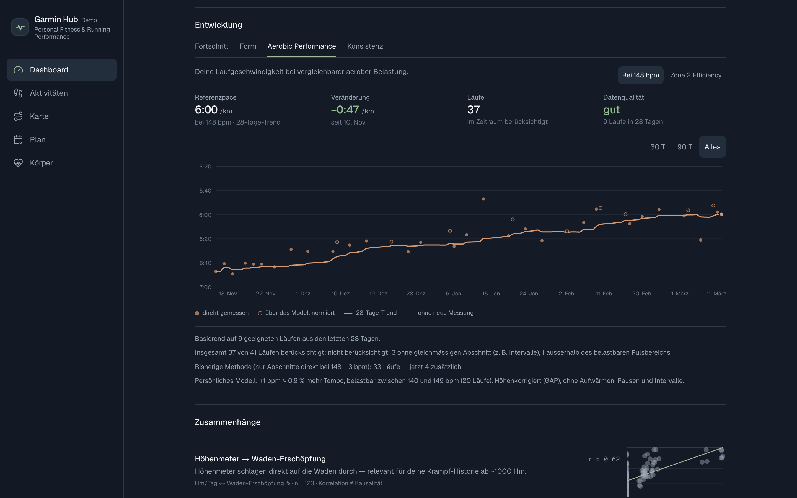

**Aerobic Performance** zeigt die Laufgeschwindigkeit bei vergleichbarer aerober
Belastung: Jeder Lauf wird in gleichmässige 5-Minuten-Abschnitte zerlegt
(ohne Aufwärmen, Pausen, Intervalle und GPS-Ausreisser, höhenkorrigiert), über
ein persönliches Puls-Tempo-Modell auf 148 bpm normiert — mit begrenzter
Extrapolation — und zu einem rollierenden 28-Tage-Trend zusammengefasst. Auch
lockere Zone-2-Läufe zählen; zusätzlich gibt es eine eigene Zone-2-Auswertung.
Details: [Aerobic Performance](docs/AEROBE-LEISTUNG.md).

### Adaptiver Trainingsplan

Ziel: **Laufleistung, Ausdauer und allgemeine Fitness verbessern.** Der
regelbasierte Generator plant jede Woche im festen Rhythmus:

| Montag | Dienstag | Mittwoch | Donnerstag | Freitag | Samstag | Sonntag |
| --- | --- | --- | --- | --- | --- | --- |
| Gym: Brust/Trizeps + Rumpf | Intervalle | Lockerer Lauf (Zone 2) | Gym: Rücken/Bizeps + Beine | Ruhetag | frei | frei |

Der Intervall-Schwerpunkt wechselt im **4-Wochen-Block**: VO₂max (5 × 3 Min),
Hügel (8 × 75 s), Tempo an der Schwelle (5 × 1 km), dann eine Entlastungswoche
(4 × 60 s, Umfang −30 %). Die bestehenden Regeln der Engine bleiben aktiv: höchstens
+10 % Laufumfang pro Woche, Deckelung bei ACWR > 1.3, Extra-Ruhetag bei TSB < −20,
Tausch der harten Einheit bei müden Beinen, Hinweise bei tiefer Readiness. Nach
jedem Sync schwächt `passePlanAn()` offene Läufe ab, wenn die Belastung es verlangt.
Am Wochenende entsteht nie eine Pflichteinheit — freiwillige Läufe fliessen über
die Belastungswerte in die Steuerung ein. Details: [Engine](docs/ENGINE.md).

Einheiten gehen über `workout-service` als strukturiertes Workout in den
Garmin-Kalender. „Läufe an Garmin senden" überträgt die Woche gesammelt mit
Vorschau und ohne Duplikate; Gym-Einheiten sind standardmässig ausgenommen.
Ziel-Herzfrequenzen kommen aus den Zonen, die im Garmin-Konto hinterlegt sind.
Der Workout-Generator baut zusätzlich spontane Läufe — etwa fürs freie Wochenende —
mit den eigenen Paces und zeigt die Wirkung auf die Form von morgen.

Planwochen vor dem Programmstart (23.11.2026) bleiben in der Datenbank erhalten und
erscheinen neutral und schreibgeschützt als Archiv.

### Smart Weight Tracking

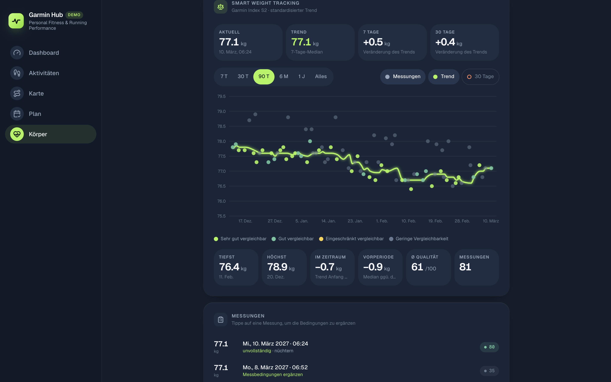

Die Wägungen der **Garmin Index S2** kommen automatisch mit dem Sync — jede Messung
mit ihrem Zeitstempel, mehrere pro Tag einzeln, inklusive Körperfett,
Körperwasser, Muskel- und Knochenmasse und BMI. Weil Gewicht im Tagesverlauf
schwankt, bewertet ein **Messqualitäts-Score** (0–100), wie gut eine Messung mit
standardisierten Bedingungen vergleichbar ist: morgens, nüchtern, vor dem
Frühstück, nach dem Toilettengang, mit Abstand zu Essen, Trinken, Sport und Sauna,
zur üblichen Zeit. Fehlende Angaben zählen nie als erfüllt.

Die Rohmessungen bleiben unverändert sichtbar. Der **standardisierte Trend** ist ein
gleitender 7-Tage-Median aus der vergleichbarsten Messung pro Tag — ohne
aufgefüllte Tage und ohne künstliche Kilogramm-Korrekturen. Fehlende
Messbedingungen ergänzt das Messprotokoll „Wie war deine Messung?" in wenigen
Taps. Details: [Smart Weight Tracking](docs/GEWICHT.md).

### Aktivitätsanalyse

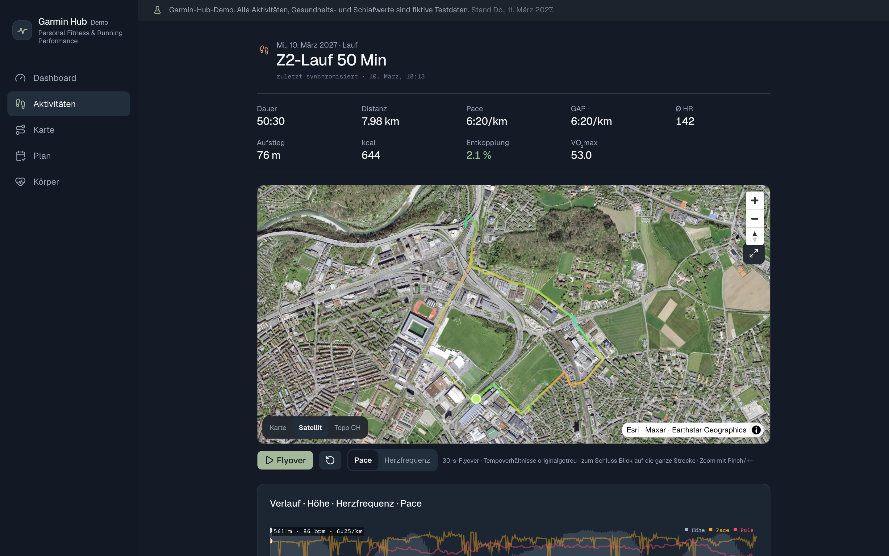

Jede Aktivität hat eine Detailseite mit Dauer, Distanz, Pace, GAP (höhenkorrigiert
nach Minetti), Herzfrequenz, Aufstieg, Kalorien, aerober Entkopplung und VO₂max. Der
**3D-Flyover** fährt die Strecke auf MapLibre mit Terrain ab; Geschwindigkeit,
Scrubber und Live-Werte lassen sich steuern. Die Route ist nach Pace oder
Herzfrequenz eingefärbt, das Höhenprofil ist mit der Karte verbunden.

Aktivitäten lassen sich lokal ausblenden (bei Garmin bleiben sie erhalten) und
einzeln oder gesammelt neu von Garmin laden.

### Routen-Builder und Karten

Der Routen-Builder routet per Klick über die freie BRouter-API. Er zeigt Distanz,
Höhenmeter und eine Dauer auf Basis der eigenen GAP-Pace. Kartentypen: Vektorkarte
(OpenFreeMap), Satellit (Esri World Imagery) und Topo CH (swisstopo). Gespeicherte
Routen lassen sich als Course an Garmin senden; GPX-Export dient als Ausweichweg.

### Körper- und Muskelanalyse

Die Body-Map zeigt die geschätzte Rest-Erschöpfung von 16 Muskelgruppen aus Kraft-
und Laufeinheiten mit muskelspezifischem exponentiellem Abbau. Das Modell ist eine
Heuristik und in der App so gekennzeichnet. Der Plan-Generator meidet harte
Einheiten für stark belastete Muskelgruppen. Ein Tipp auf einen Muskel öffnet ein
Detail mit Rest-Erschöpfung, Zeit bis zur vollen Belastbarkeit, Verlauf über
14 Tage und den Einheiten, die beigetragen haben.

### Schlaf

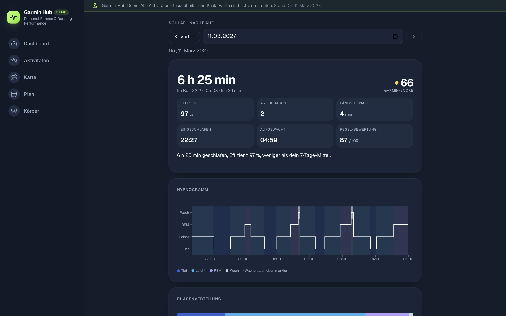

Die Detailansicht zeigt jede Nacht vollständig: Hypnogramm, Phasenverteilung mit
Richtwerten, Herzfrequenz, Sauerstoffsättigung mit Schwellen bei 90 und 92 %,
Atemfrequenz je Schlafphase, HRV gegen das persönliche Garmin-Band, Stress, Body
Battery sowie Bewegung und Unruhe. Die Analyse vergleicht jede Kernmetrik mit dem
7- und 30-Tage-Mittel und gibt regelbasierte Empfehlungen fürs Training. Alle Werte
sind Schätzungen der Uhr und kein medizinischer Befund. Details:
[Schlaf](docs/SCHLAF.md).

### Garmin-Synchronisation

Der Sync läuft inkrementell und in Chunks, damit er die 60 Sekunden einer
Vercel-Function nicht überschreitet. Jeder Aufruf verarbeitet höchstens 12
Aktivitäten, 7 Gesundheitstage, 6 Gewichtsblöcke à 90 Tage oder 15 Schlafnächte
und meldet `hasMore`. Der Sync-Knopf ruft weiter auf, bis alles da ist, und zeigt
den Fortschritt. Zwischen den Garmin-Anfragen liegen etwa 350 ms Pause.

Ein **täglicher Cron** (05:00 UTC) synchronisiert Aktivitäten, Herzfrequenzzonen,
die letzten Gesundheitstage und neue Wägungen. Danach berechnet `recomputeAll()`
Fitness, Muskelstatus, Laufmodell und Schlafaufbereitung neu; sonntags plant der
Cron die Folgewoche.

### Offline-Funktionen und PWA

Die App lässt sich auf iOS und Android installieren. Der Service Worker
([`public/sw.js`](public/sw.js)) cacht die App-Shell und statische Assets; Seiten
laden zuerst aus dem Netz und fallen offline auf den zuletzt geladenen Stand zurück.
Kartenkacheln werden bewusst nicht gecacht. Sync, Workout-Push und Routen-Push
brauchen eine Verbindung.

## Öffentliche Demo

Unter **`/demo`** (z. B. `https://garmin-hub.vercel.app/demo`) läuft eine Demo ohne
Login, ohne Garmin-Konto und ohne Datenbank. Sie nutzt dieselben Seiten und
Komponenten wie die App: Dashboard, Aktivitäten mit Detail und 3D-Flyover, Karte,
Plan, Körper mit Smart Weight Tracking und Schlaf. Einstellungen und
Garmin-Verbindung gibt es in der Demo nicht. Ein Banner kennzeichnet alle Werte als
fiktiv; mit `NEXT_PUBLIC_PORTFOLIO_URL` erscheint daneben ein Link „Zum Portfolio".

**Datenquelle: statischer Snapshot statt Demo-DB.** Die Demo liest ausschliesslich
JSON-Dateien aus [`public/demo/daten/`](public/demo/daten). Es gibt keinen Code-Pfad
zu einer Datenbank; fehlt der Snapshot, zeigt `/demo` einen Fehler.

**Erzeugung.** `pnpm demo:daten` startet ein In-Memory-Postgres
([PGlite](https://pglite.dev), nur devDependency) mit den echten Migrationen und
spielt das Training einer erfundenen Person (*Alex Muster*) Woche für Woche durch:
echte Engine-Neuberechnung, echter Plan-Generator, danach werden die geplanten
Einheiten „absolviert", am freien Wochenende kommen freiwillige Läufe und
Wanderungen dazu, und eine Waage liefert Wägungen mit teils ausgefülltem
Messprotokoll. Gespeichert werden die Antworten der echten Services. Alles ist
synthetisch und deterministisch; die Strecken liegen auf öffentlichen Wegen um Bern
([`scripts/demo/routen.json`](scripts/demo/routen.json)).

**Festes Demo-Heute.** Der Snapshot zeigt Donnerstag, 11. März 2027, 20:15 Uhr. Die
Demo stellt die App-Uhr im Browser auf diesen Zeitpunkt (`jetztMs()` in
`lib/format.ts`), damit Woche, „letzte Nacht" und Plan stimmig bleiben.

**Abgrenzung.**

- Die Middleware gibt nur `/demo` und `/demo/*` ohne Session frei
  ([`lib/oeffentliche-pfade.ts`](lib/oeffentliche-pfade.ts)) und lässt dort nur GET
  und HEAD zu. Alle anderen Seiten und alle `/api/*`-Endpunkte bleiben geschützt.
- Header wie `x-demo` verwirft die Middleware; ob etwas Demo ist, entscheidet nur der Pfad.
- In der Demo beantwortet [`lib/demo/api.ts`](lib/demo/api.ts) die Lesezugriffe der
  Komponenten im Browser aus dem Snapshot; kein Aufruf erreicht einen geschützten
  Endpunkt. Jede andere Methode als GET wird abgelehnt.
- Sync, Senden an die Uhr, Plan-Generierung, Messprotokoll, Löschen und Routen
  speichern sind ausgeblendet oder mit „In der Demo deaktiviert." gesperrt.

## Sicherheit und Datenschutz

Garmin Hub greift über die **inoffizielle Garmin-Connect-API** auf das eigene Konto zu.

- **Nicht offiziell unterstützt.** Garmin kann die Schnittstelle jederzeit ändern oder sperren. Die Nutzung erfolgt auf eigenes Risiko.
- **Nur ein Konto.** Die App ist als persönliches Single-User-Projekt gebaut. Sie hat ein einziges App-Passwort und keine Benutzerverwaltung.
- **Zugangsdaten schützen.** `GARMIN_EMAIL` und `GARMIN_PASSWORD` liegen nur als Umgebungsvariablen auf dem Server. Der Browser spricht nie direkt mit Garmin.
- **Verschlüsselte Token.** Nach dem ersten Login speichert die Python-Bridge die garth-Token AES-GCM-verschlüsselt in `garmin_tokens` ([`api/_lib/crypto.py`](api/_lib/crypto.py)). Der Schlüssel `TOKEN_ENC_KEY` liegt nur in der Umgebung.
- **Rate-Limits beachten.** Häufige frische Logins können bei Garmin Rate-Limits, Captchas oder MFA auslösen. Deshalb werden die Token wiederverwendet, und die App begrenzt Sync (240 pro 10 Min), Push (60 pro 10 Min) und Login (8 pro 15 Min).
- **Keine Secrets im Repository.** `.env.local` ist in `.gitignore`. Zugangsdaten, Token und Schlüssel gehören nie in GitHub, auch nicht in Issues oder Screenshots.

Weitere Schutzmassnahmen im Code:

- Middleware schützt alle Seiten und Routen ausser Login, Cron und Bridge. Route-Handler prüfen die Session zusätzlich.
- Login mit zeitkonstantem Passwortvergleich und signiertem HttpOnly-Cookie (30 Tage, `jose`).
- Die Bridge akzeptiert nur Anfragen mit `x-internal-key`; der Cron nur mit `Authorization: Bearer $CRON_SECRET`.
- CSP mit Nonce, HSTS, `X-Frame-Options: DENY`, Referrer- und Permissions-Policy, `noindex`.
- Schlaf- und Gewichtsdaten gelten als sensibel: Werte erscheinen weder in Logs noch in Fehlermeldungen.

Für einen eigenen Betrieb sind zusätzlich nötig: starke, zufällige Werte für alle
Secrets, ein starkes `APP_PASSWORD` und in Vercel die **Deployment Protection** für
Preview-Deployments, sonst sind Preview-URLs öffentlich erreichbar.

## Lokal starten

### Voraussetzungen

| Werkzeug | Version | Wofür |
| --- | --- | --- |
| Node.js | 20 LTS oder neuer (Next.js 15 braucht mindestens 18.18) | Next.js-App |
| pnpm | 9 | Paketverwaltung (`pnpm-lock.yaml`) |
| Python | 3.10 oder neuer (Vercel nutzt 3.12) | Garmin-Bridge |
| PostgreSQL | 16 empfohlen, z. B. ein kostenloses Supabase-Projekt, dazu `psql` | Datenbank |
| Vercel CLI | aktuell, mit Login | Bridge lokal (`vercel dev`) und Deployment |
| Garmin-Connect-Konto | normales Konto, kein Developer-Zugang nötig | Datenquelle |

### Schritt für Schritt

1. Repository klonen und Abhängigkeiten installieren:

   ```sh
   git clone https://github.com/bien187/garmin-hub.git
   cd garmin-hub
   pnpm install
   ```

2. Umgebungsvariablen anlegen und ausfüllen (siehe [nächster Abschnitt](#umgebungsvariablen-und-externe-dienste)):

   ```sh
   cp .env.example .env.local
   ```

3. Datenbankschema anwenden. Die vier Migrationen laufen der Reihe nach; alle sind
   idempotent und rein additiv:

   ```sh
   psql "$DATABASE_URL" -f drizzle/0000_init.sql
   psql "$DATABASE_URL" -f drizzle/0001_whole_wasp.sql
   psql "$DATABASE_URL" -f drizzle/0002_schlaf.sql
   psql "$DATABASE_URL" -f drizzle/0003_gewicht.sql
   ```

   Für eine neue, leere Datenbank funktioniert alternativ `pnpm db:push`. Gegen eine
   bestehende Produktionsdatenbank nicht verwenden, weil Drizzle dabei destruktive
   Änderungen vorschlagen kann.

4. Next.js-App starten:

   ```sh
   pnpm dev
   ```

   Öffne [localhost:3000](http://localhost:3000) und melde dich mit `APP_PASSWORD` an.

5. Für den Garmin-Sync auch die Python-Bridge starten. `pnpm dev` startet sie **nicht**.
   Mit der Vercel CLI laufen Next.js und Python zusammen:

   ```sh
   vercel link   # einmalig, Projekt verknüpfen
   vercel dev
   ```

   Die Vercel CLI braucht dafür [uv](https://docs.astral.sh/uv/) im `PATH`. Danach auf
   dem Dashboard **Sync** drücken. Verlangt Garmin einen MFA-Code, erscheint ein
   Hinweis; der Code wird unter **Einstellungen → Garmin-Verbindung** eingegeben.

### Was ohne externe Dienste läuft

| Komponente | Lokal ohne Internet | Braucht externe Dienste |
| --- | --- | --- |
| Oberfläche, Engine, Plan, Auswertungen | ja, mit einer lokalen PostgreSQL-Datenbank | – |
| Garmin-Sync, Workout- und Routen-Push | – | Garmin Connect, Python-Bridge |
| Kartenkacheln, Terrain, Routing | – | OpenFreeMap, AWS Terrain Tiles, Esri, swisstopo, BRouter |
| Täglicher Sync | – | Vercel Cron |

Ohne Bridge zeigen Sync und Garmin-Status einen sauberen Fehlerhinweis statt eines
Absturzes. Ohne `DATABASE_URL` rendert die App leere Zustände.

### Produktionsbuild

```sh
pnpm build
pnpm start
```

Die PWA-Installation ausserhalb von `localhost` braucht HTTPS.

## Umgebungsvariablen und externe Dienste

Alle Variablen stehen mit Beispielwerten in [`.env.example`](.env.example).

| Variable | Zweck | Erzeugen |
| --- | --- | --- |
| `GARMIN_EMAIL`, `GARMIN_PASSWORD` | Login bei Garmin Connect | eigenes Konto |
| `APP_PASSWORD` | Login in die App | starkes Passwort |
| `SESSION_SECRET` | Signatur des Session-Cookies | `openssl rand -hex 32` |
| `INTERNAL_API_KEY` | Shared Secret zwischen Next.js und Bridge | `openssl rand -hex 32` |
| `DATABASE_URL` | PostgreSQL, bei Supabase der Transaction Pooler (Port 6543) | Supabase-Dashboard |
| `TOKEN_ENC_KEY` | AES-GCM-Schlüssel für die Garmin-Token, genau 64 Hex-Zeichen | `openssl rand -hex 32` |
| `CRON_SECRET` | Schützt `/api/cron/daily` | `openssl rand -hex 16` |
| `BRIDGE_URL` | Optional: Adresse der Bridge, wenn sie nicht auf derselben Domain läuft | – |
| `NEXT_PUBLIC_PORTFOLIO_URL` | Optional: Link „Zum Portfolio" im Banner der Demo (`/demo`), beim Build eingesetzt | z. B. `https://benlinusmueller.com` |

Die Python-Bridge weicht beim Supabase-Pooler automatisch auf den Session-Port 5432
aus, weil `pg8000` keine Prepared Statements über den Transaction Pooler unterstützt.

Externe Dienste, alle kostenlos und ohne API-Schlüssel ausser den eigenen Konten:
Garmin Connect, Supabase, Vercel, OpenFreeMap, AWS Terrain Tiles (Terrarium), Esri
World Imagery, swisstopo WMTS und BRouter.

## Datenbank und Migrationen

Das Schema steht in [`lib/db/schema.ts`](lib/db/schema.ts) (Drizzle ORM), die
Migrationen in [`drizzle/`](drizzle). Neue Migrationen entstehen mit
`pnpm db:generate` und sollen additiv bleiben (`CREATE TABLE IF NOT EXISTS`).

| Bereich | Tabellen |
| --- | --- |
| Garmin-Rohdaten | `activities`, `activity_streams`, `strength_sets`, `daily_health` |
| Gewicht | `gewicht_messungen` (Wägungen, nur vom Sync geschrieben), `gewicht_bedingungen` (Messprotokoll) |
| Schlaf | `sleep_nights`, `sleep_epochen`, `sleep_zeitreihen` |
| Berechnet | `computed_daily`, `muscle_state` |
| Training | `planned_workouts`, `courses`; `ep_benchmarks` bleibt als Altbestand bestehen, wird aber nicht mehr genutzt |
| Betrieb | `garmin_tokens`, `sync_state`, `app_settings`, `rate_limits` |

Beim Erst-Import holt der Sync die komplette Aktivitätshistorie, 365 Tage
Gesundheitsdaten, 5 Jahre Wägungen und 365 Nächte Schlaf. Die Schlafnächte bereitet
ein TypeScript-Parser nach dem Sync in Phasen und Minuten-Zeitreihen auf.

## Deployment

1. Kostenloses Supabase-Projekt anlegen und die Migrationen anwenden.
2. Projekt bei Vercel anlegen (`vercel`) und alle Umgebungsvariablen im Dashboard setzen.
3. Produktion deployen:

   ```sh
   vercel --prod
   ```

4. Deployment Protection für Preview-Deployments aktivieren.
5. App öffnen, anmelden und den ersten Sync starten.

Bestehende Installationen brauchen für das Smart Weight Tracking einmalig
`drizzle/0003_gewicht.sql`; bis dahin zeigt die Körper-Seite einen Hinweis, alles
andere läuft unverändert.

Der Cron steht in [`vercel.json`](vercel.json) (`0 5 * * *` auf `/api/cron/daily`);
Vercel sendet dabei automatisch `Authorization: Bearer $CRON_SECRET`.

> [!IMPORTANT]
> Vercel Hobby erlaubt höchstens **12 Serverless Functions** pro Deployment. Next.js
> bündelt die Routen zu 7 Functions, die Bridge ist eine einzige Function
> ([`api/bridge/index.py`](api/bridge/index.py)). Neue Bridge-Aktionen gehören in
> `AKTIONEN` in [`api/_lib/bridge_aktionen.py`](api/_lib/bridge_aktionen.py), neue
> Sync-Typen in `sync()` — nie in neue Dateien unter `api/`.

## Technik

| Ebene | Umsetzung |
| --- | --- |
| App | Next.js 15 App Router, React 19, TypeScript strict, Turbopack |
| Oberfläche | Tailwind CSS 4, shadcn/ui (Radix UI), Lucide, Geist |
| Diagramme | Recharts |
| Karten | MapLibre GL, Turf, OpenFreeMap, AWS Terrain Tiles, BRouter |
| Daten | PostgreSQL (Supabase), Drizzle ORM, postgres.js, Zod |
| Garmin-Bridge | Python, `garminconnect` 0.2.25, `garth` 0.5.2, `pg8000`, `cryptography` |
| Auth | Passwort-Login, signiertes Cookie mit `jose` |
| Hosting | Vercel Hobby mit Cron, PWA mit Service Worker |
| Prüfungen | Vitest, ESLint, TypeScript, Playwright für Screenshots und Layout-Checks |

### Design-System

**„Understated Performance"**: ruhig, flach und von der Typografie getragen. Die
Tokens stehen zentral in [`app/globals.css`](app/globals.css):

| Rolle | Farbe | Token |
| --- | --- | --- |
| Hintergrund | `#151B26` | `--background` |
| Fläche | `#1C2532` | `--card` |
| Erhöhte Fläche (Eingaben, Segmente) | `#232E3C` | `--surface` |
| Text primär · sekundär | `#F0F2F4` · `#9AA5B3` | `--foreground` · `--muted-foreground` |
| Akzent, Fortschritt (Muted Sage) | `#A4B99A` | `--primary` |
| Erholung, Schlaf, Ausdauer (Soft Blue) | `#8FA6C1` | `--blau` |
| Laufen, Intensität (Muted Orange) | `#D69A72` | `--coral` |
| Trennlinien | `#303A47` | `--border` |

Die gedämpften Ampelfarben (`--status-*`) sind nur für Status da. Keine Schatten,
kein Glow, keine Verläufe; Radien 6 · 8 · 10 · 12 px. Inhalte gliedern sich über
Abschnitte mit feinen Trennlinien (`Abschnitt`) statt über verschachtelte Karten;
Bewegung beschränkt sich auf kurze Farbübergänge. Alle Diagramme nutzen denselben
Baukasten ([`components/ui/diagramm.tsx`](components/ui/diagramm.tsx)) nach dem Vorbild
von Aerobic Performance: Kennzahlen über dem Diagramm, Zeitraum rechts darüber, feine
waagrechte Hilfslinien ohne Achsenlinien, einheitlicher Tooltip, Legende und Erklärung
darunter sowie feste Farben je Bedeutung (Pace Orange, Puls Rot, Fortschritt Salbei,
Erholung Blau, Höhe neutral). Wiederkehrende Bausteine:
`Abschnitt`, `Card`, `KachelKopf`, `Pill`, `Ring`/`Balken`, `SportIcon`/`EinheitIcon`
und `Logo`. Der optionale Hellmodus (`.light`) nutzt dieselben Rollen.

## Architektur

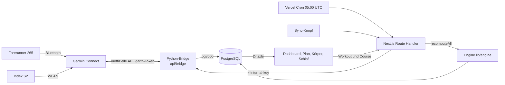

Die Oberfläche rendert nie direkt gegen Garmin, sondern immer aus der eigenen
Datenbank. Nur drei Aktionen sprechen live mit Garmin: Sync, Workout-Push und
Routen-Push. Die Engine besteht aus reinen, deterministischen Funktionen und berechnet
nach jedem Sync die abgeleiteten Werte. Ausführlich: [Architektur und
Sync-Strategie](docs/ARCHITEKTUR.md).

## Projektstruktur

```text
app/                  Seiten (Dashboard, Aktivitäten, Karte, Plan, Körper, Schlaf) und API-Routen
api/bridge/index.py   Python-Bridge zu Garmin Connect (eine Vercel-Function)
api/_lib/             Garmin-Client, Sync-Logik (inkl. Gewicht), Verschlüsselung, Bridge-Aktionen
components/           UI nach Bereichen (dashboard, activities, map, plan, body, schlaf, ui)
lib/engine/           Engine: TRIMP, Fitness, GAP, Riegel, Muskeln, Plan, Block, Gewicht, Schlaf
lib/server/           Datenbankzugriff und Dienste für die Seiten
lib/db/               Drizzle-Schema und Verbindung
drizzle/              SQL-Migrationen
public/               Icons, Manifest, Service Worker und Demo-Datenstand
scripts/              Werkzeuge (Icons, Demo-Daten, Garmin-Dumps, Screenshots, Layout-Checks)
tests/fixtures/       Echte Garmin-Antworten ohne Personendaten für Parser-Tests
docs/                 Weitere Dokumentation und Screenshots
```

## Tests

```sh
pnpm test                 # Vitest
npx tsc --noEmit          # Typecheck
pnpm lint                 # ESLint
pnpm build                # Produktionsbuild
pnpm demo:daten           # Demo-Datenstand neu erzeugen (public/demo/daten)
python scripts/garmin/test_schlaf_sync.py    # Schlaf-Sync der Bridge offline gegen Fixtures
python3 scripts/garmin/test_gewicht_sync.py  # Gewichts-Sync der Bridge offline
```

Die Tests decken die Engine ab: TRIMP, CTL/ATL/TSB, GAP, Riegel, Muskelabbau,
Trainingsplan im festen Rhythmus, Trainingsblock, Verfügbarkeit, Plan-Anpassung,
Wochenstatistik, Messqualitäts-Score und Gewichtstrend sowie Schlaf-Parser und
Schlaf-Analyse. Ein Demo-Test prüft zusätzlich, dass der Datenstand keine Altlasten
des früheren Programms enthält. Die öffentliche Demo prüft ein End-to-End-Skript
gegen einen laufenden Server, ohne Login, auf Desktop und 390 px:
`GHQ_URL=http://127.0.0.1:3999 node scripts/verify-demo.mjs`.

### Screenshots neu aufnehmen

Die Aufnahmen in `docs/screenshots` entstehen aus der Demo — ohne Datenbank und
ohne Login:

```sh
pnpm build && pnpm start -p 3999
GHQ_URL=http://127.0.0.1:3999 node scripts/readme/screenshots.mjs
```

Mit `GHQ_CHROME=1` nutzt das Skript das lokal installierte Google Chrome, mit
`GHQ_NUR=mobile-plan,desktop-plan` nur ausgewählte Aufnahmen.

## Weitere Dokumentation

| Dokument | Inhalt |
| --- | --- |
| [ARCHITEKTUR.md](docs/ARCHITEKTUR.md) | Datenfluss, Python-Hosting und Sync-Strategie |
| [ENGINE.md](docs/ENGINE.md) | Formeln der Analyse-Engine und Regeln des Trainingsplans |
| [AEROBE-LEISTUNG.md](docs/AEROBE-LEISTUNG.md) | Aerobic Performance: Abschnitte, individuelles Modell, 28-Tage-Trend, Zone 2 Efficiency |
| [GEWICHT.md](docs/GEWICHT.md) | Smart Weight Tracking: Sync, Messqualität, Trend |
| [SCHLAF.md](docs/SCHLAF.md) | Schlaf-Datenmodell, Sync, Backfill, Analyse-Regeln und Ansichten |
| [GARMIN-DATENFORMAT.md](docs/GARMIN-DATENFORMAT.md) | Felder, Zeitformate und Auflösungen der Garmin-Antworten |
| [ANNAHMEN.md](docs/ANNAHMEN.md) | Dokumentierte Annahmen und bewusst kurze Zeitfenster |
| [instructions.md](instructions.md) | Spezifikation des Projekts |
| [CLAUDE.md](CLAUDE.md) | Befehle, Konventionen und Hinweise für die Weiterentwicklung |

## Bekannte Grenzen

- **Inoffizielle API.** Ändert Garmin Endpunkte oder Login, kann der Sync ausfallen, bis die Bibliotheken nachziehen. Für Courses dient GPX-Export als Ausweichweg.
- **Single User.** Ein Konto, ein Passwort, keine Mandantentrennung.
- **Bridge lokal nur mit Vercel CLI.** `pnpm dev` startet die Python-Bridge nicht.
- **Schätzungen.** Muskelmodell, Schlafwerte und Körperzusammensetzung sind Modelle bzw. Geräte-Schätzungen, keine Messungen oder Diagnosen. Der Messqualitäts-Score bewertet Vergleichbarkeit, nicht Genauigkeit.
- **Kraft-Workouts.** Das Garmin-Workout-Format bildet nicht jede Satzstruktur ab; Übungen landen als beschriftete Schritte auf der Uhr.
- **Hellmodus.** Die App ist Dark-first; die Farben für den Hellmodus existieren, ein Umschalter in der Oberfläche fehlt.
- **Vercel Hobby.** Function-Laufzeit 60 Sekunden, höchstens 12 Functions, nur tägliche Crons.

Garmin Hub ist ein unabhängiges, privates Projekt ohne Verbindung zu Garmin Ltd.
„Garmin", „Forerunner" und „Index" sind Marken der Garmin Ltd.
